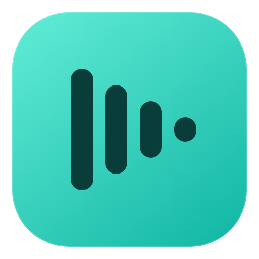
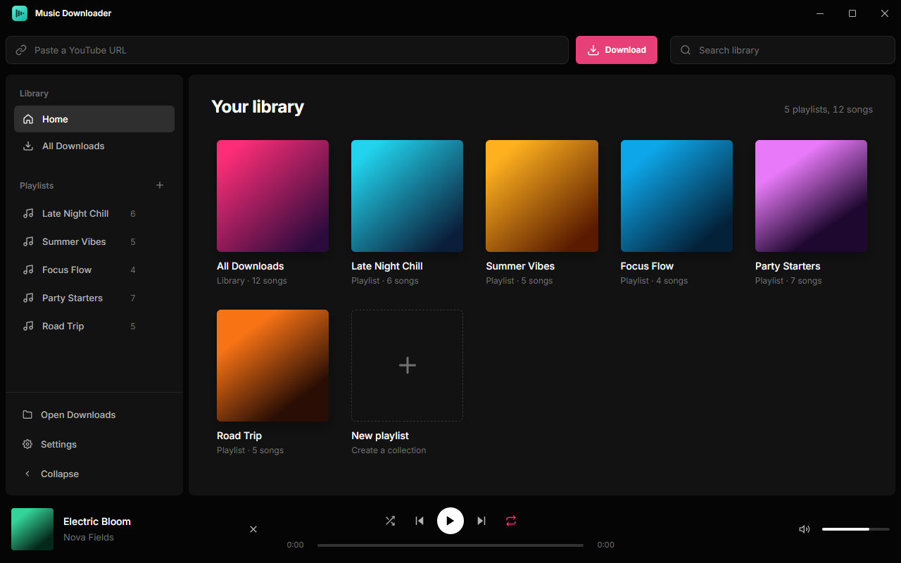
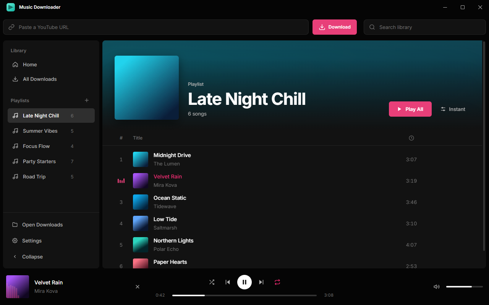
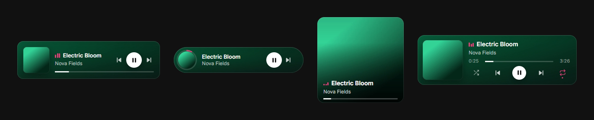
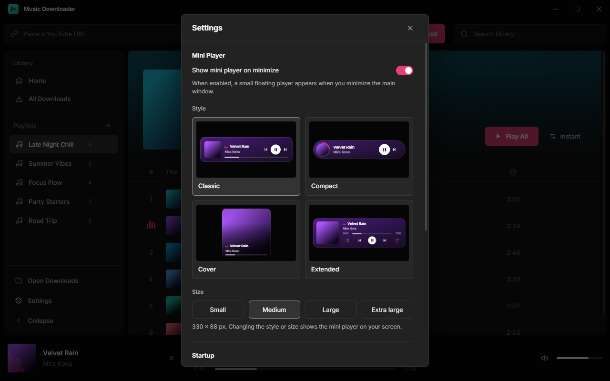
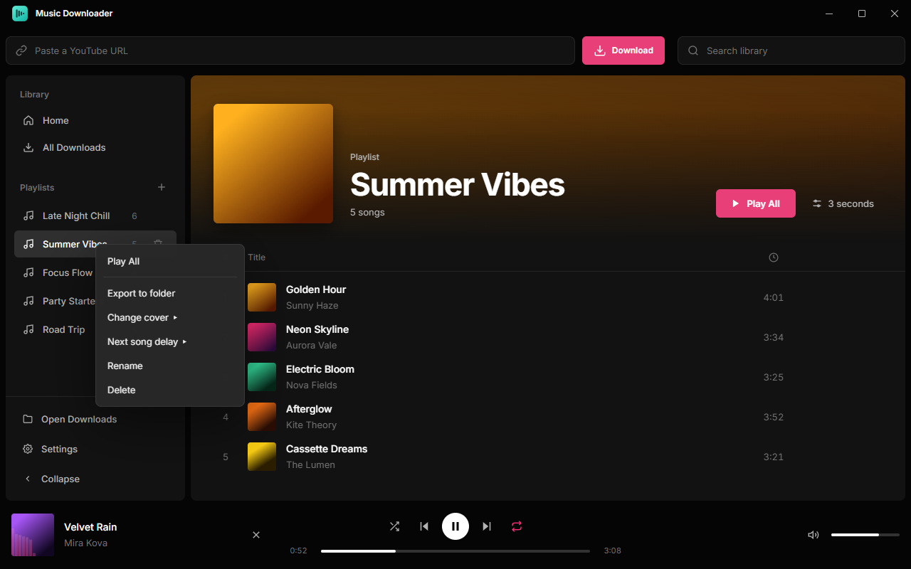
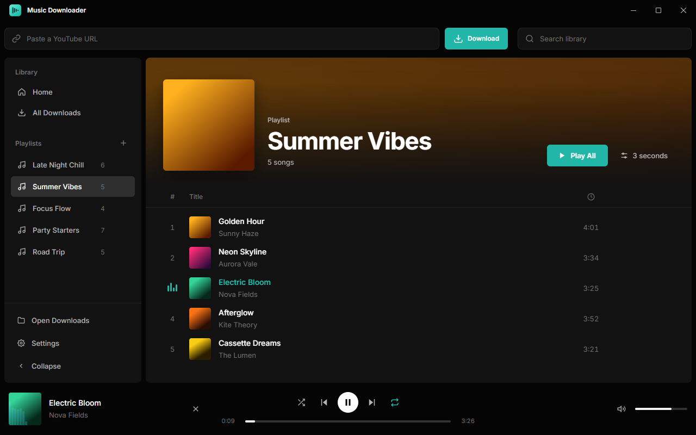

<p align="center">
  
</p>

<h1 align="center">Music Downloader</h1>

<p align="center">
  <strong>YouTube music downloader & playlist manager</strong><br />
  <sub>Download · Organize · Play — all in one app</sub>
</p>

<p align="center">
  <a href="https://github.com/belinda-hagen/Music-Downloader/releases/latest"></a>
  <a href="https://github.com/belinda-hagen/Music-Downloader/releases"></a>
  
  
  <a href="LICENSE"></a>
  <a href="https://github.com/belinda-hagen/Music-Downloader/stargazers"></a>
</p>

<p align="center">
  
</p>

---

## What's New in 1.4

- **New name** — PlayGen is now **Music Downloader**. Installing it over PlayGen keeps your library, playlists and settings
- **Home page** — a start page with a cover card for every playlist, plus a one-click card to create a new one
- **Mini player styles & sizes** — pick **Classic**, **Compact**, **Cover** or **Extended**, in four sizes from Small to Extra large; changing either shows a live preview on your screen
- **Color themes** — switch the accent between **Rose**, **Ocean**, **Ember** and **Violet**
- **Import local files** — drag audio files from your PC onto the window or onto a playlist
- **Multi-select** — `Ctrl`/`Shift`-click (or `Ctrl+A`) to drag several songs into a playlist at once
- **Edit track info** — fix a song's title and artist and fetch matching cover art
- **Intro animation** — a short logo animation on launch (can be turned off in Settings)
- **Refreshed app icon**

## Features

### Download & import

| Feature | Description |
|---|---|
| **Download from YouTube** | Paste a video link and get a high-quality MP3 |
| **Download whole playlists** | Paste a YouTube playlist link to grab every track at once |
| **Import local files** | Drag audio files from your PC onto the window, or straight onto a playlist |
| **Edit track info** | Fix a song's title and artist and fetch matching cover art |

### Library & playlists

| Feature | Description |
|---|---|
| **Home page** | Start page with a cover card for every playlist |
| **Playlist system** | Create, rename, reorder (drag-and-drop) & delete playlists |
| **Multi-select** | `Ctrl`/`Shift`-click songs to drag several into a playlist at once |
| **Playlist covers** | Upload your own cover image or use a song's artwork |
| **Next-song delay** | Set a per-playlist gap between tracks (Instant → 30 seconds) |
| **Export to folder** | Copy a whole playlist's MP3s to any folder on your PC |
| **Search** | Instantly filter songs across your library |

### Playback

| Feature | Description |
|---|---|
| **Full music player** | Play/pause, skip, shuffle, repeat, seek & volume |
| **Adaptive cover art** | The now-playing banner tints itself to match the album art |
| **Audio visualizer** | Real-time equalizer bars on the album thumbnail |
| **Mini player** | Always-on-top player when minimized, in four styles and four sizes |
| **Resume where you left off** | Your last song, playlist, volume, shuffle and repeat are restored on launch |

### Personalization

| Feature | Description |
|---|---|
| **Color themes** | Rose, Ocean, Ember or Violet accent colors |
| **Collapsible sidebar** | Hide the sidebar for more room |
| **Up-to-date downloader** | The bundled yt-dlp updates itself once a day, so downloads keep working |

> **Tip:** Right-click a playlist to **rename** it, change its **cover**, set its **next-song delay**, or **export** all its tracks to a folder. Inside a playlist a song is only *removed* from that playlist — permanent deletion lives in the **All Downloads** view.

## Screenshots

<p align="center">
  <br />
  <sub>Playlist view — the banner adapts to the cover art while the visualizer runs on the thumbnail</sub>
</p>

<p align="center">
  <br />
  <sub>Mini player styles — Classic, Compact, Cover and Extended</sub>
</p>

<table>
  <tr>
    <td width="50%"></td>
    <td width="50%"></td>
  </tr>
  <tr>
    <td align="center"><sub>Settings — mini player style, size, startup, yt-dlp updates and theme</sub></td>
    <td align="center"><sub>Right-click a playlist for export, cover, delay and rename</sub></td>
  </tr>
  <tr>
    <td colspan="2"></td>
  </tr>
  <tr>
    <td colspan="2" align="center"><sub>The Ocean color theme</sub></td>
  </tr>
</table>

## Install

Download `Music-Downloader-<version>-win-x64.exe` from the [latest release](https://github.com/belinda-hagen/Music-Downloader/releases/latest) and run it. To update, run the newer installer — your library, playlists and settings are kept.

## Run from Source

| Tool | Install |
|------|---------|
| **Node.js** 18+ | [nodejs.org](https://nodejs.org) |
| **yt-dlp** | Bundled on Windows. Elsewhere: [GitHub releases](https://github.com/yt-dlp/yt-dlp/releases) |
| **ffmpeg** | Bundled on Windows. Elsewhere: [ffmpeg.org](https://ffmpeg.org/download.html) |

```bash
git clone https://github.com/belinda-hagen/Music-Downloader.git
cd Music-Downloader
npm install
npm start
```

## Keyboard Shortcuts

| Key | Action |
|-----|--------|
| `Space` | Play / Pause |
| `←` / `→` | Seek −5s / +5s |
| `Ctrl+←` / `Ctrl+→` | Previous / Next track |
| `↑` / `↓` | Volume up / down |
| `S` | Toggle shuffle |
| `R` | Cycle repeat |
| `Ctrl+F` | Focus search |
| `Ctrl+A` | Select all songs in the current view |
| `Esc` | Clear the song selection |
| `Ctrl+V` | Paste a copied YouTube link into the download bar |

## Disclaimer

This tool is intended for downloading content you have the right to download. Users are responsible for complying with applicable laws and YouTube's Terms of Service. The developers of Music Downloader do not condone or encourage downloading copyrighted material without permission.

## 📄 License

[MIT](LICENSE)
